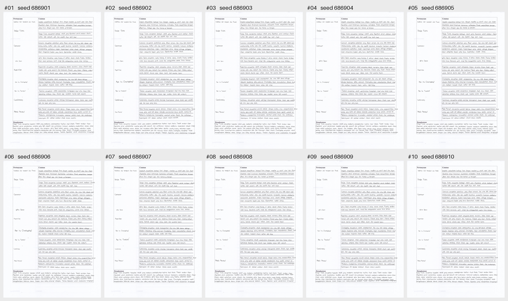

# Cornell Notes Otomatis ✍️


Program Python untuk **mengisi template Cornell Notes (CN) secara otomatis** dari file teks, memakai **font tulisan tangan milikmu sendiri**. Tiap huruf diputar, digeser, dan diubah ukurannya sedikit-sedikit secara acak sehingga hasilnya tampak seperti ditulis tangan. Tidak perlu lagi mengedit template satu per satu di Canva atau Adobe Acrobat.

Satu kali jalan menghasilkan **10 variasi CN yang berbeda**, lengkap dengan lembar ringkasan, sehingga kamu bisa memilih mana yang paling layak pakai.



> Gambar contoh dibuat dengan font pengganti (bukan font tulisan tangan). Hasil dengan fontmu sendiri akan terlihat jauh lebih natural.

---

## Daftar isi

- [Fitur](#fitur)
- [Isi repositori](#isi-repositori)
- [Instalasi](#instalasi)
- [Mulai cepat](#mulai-cepat)
- [Format file catatan](#format-file-catatan)
- [Mengatur ukuran kalimat](#mengatur-ukuran-kalimat)
- [Opsi baris perintah](#opsi-baris-perintah)
- [Pengaturan tampilan tulisan tangan](#pengaturan-tampilan-tulisan-tangan)
- [Mengatur posisi dan mode kalibrasi](#mengatur-posisi-dan-mode-kalibrasi)
- [Hasil keluaran](#hasil-keluaran)
- [Membuat ulang variasi yang bagus](#membuat-ulang-variasi-yang-bagus)
- [Cara kerja singkat](#cara-kerja-singkat)
- [Pemecahan masalah](#pemecahan-masalah)
- [Catatan penggunaan](#catatan-penggunaan)

---

## Fitur

- **Tulisan tangan dari fontmu sendiri** (`.ttf` / `.otf`).
- **Efek tulisan tangan yang bisa diatur**: rotasi huruf, naik-turun huruf, variasi ukuran huruf dan kata, jarak antar huruf, kemiringan baris, tekanan pulpen (transparansi), dan blur tinta.
- **10 variasi per eksekusi** dengan acakan berbeda, ditambah `ringkasan.png` untuk membandingkan semuanya sekaligus.
- **Seed per variasi**: variasi yang bagus bisa dibuat ulang persis sama.
- **Deteksi otomatis garis tulis dan kotak** pada template, jadi tetap pas walau resolusi gambarmu berbeda.
- **Mode kalibrasi** (`--kalibrasi`): menggambar garis bantu di atas template untuk melihat posisi tulisan sebelum dibuat.
- **Ukuran kalimat Pertanyaan berbeda-beda**, otomatis acak atau manual dengan penanda `@besar`, `@kecil`, `@1.3`.
- **Teks otomatis turun baris** (word wrap) dengan indent gantung untuk daftar (`-`, `•`, `1.`, `a.`).
- **Banyak halaman otomatis** jika catatan lebih panjang dari satu halaman.
- **Keluaran PNG dan PDF**.
- **Penanganan karakter yang tidak ada di font** (misalnya `²` menjadi `^2`).

## Isi repositori

| File | Fungsi |
|---|---|
| `cornell_notes.py` | Untuk template CN **lengkap**: kotak Topik, Nama, NIM, Tanggal, Pertanyaan, Catatan, Rangkuman. |
| `cornell_notes_lanjutan.py` | Untuk template **halaman lanjutan**: hanya Pertanyaan, Catatan, Rangkuman (tanpa header). |
| `contoh_catatan.txt` | Contoh isi catatan untuk `cornell_notes.py`. |
| `contoh_catatan_lanjutan.txt` | Contoh isi catatan untuk `cornell_notes_lanjutan.py`. |

Template gambar (`CN.jpg`, `CN_Sebelahnya.jpg`) dan file font **disediakan sendiri** karena bergantung pada template dan font yang kamu pakai.

Struktur folder yang disarankan:

```
.
├── cornell_notes.py
├── cornell_notes_lanjutan.py
├── contoh_catatan.txt
├── contoh_catatan_lanjutan.txt
├── CN.jpg                  # template lengkap (sediakan sendiri)
├── CN_Sebelahnya.jpg       # template halaman lanjutan (sediakan sendiri)
├── FontKu.ttf              # font tulisan tangan (sediakan sendiri)
└── hasil/                  # dibuat otomatis
```

## Instalasi

Butuh **Python 3.8+**.

```bash
git clone https://github.com/<username>/<nama-repo>.git
cd <nama-repo>
pip install pillow numpy
```

Atau lewat `requirements.txt`:

```
pillow>=9.4
numpy>=1.17
```

## Mulai cepat

1. Letakkan template, file font, dan file catatan `.txt` di folder yang sama.
2. **Cek posisi** lebih dulu dengan mode kalibrasi:

   ```bash
   python cornell_notes.py contoh_catatan.txt --font FontKu.ttf --template CN.jpg --kalibrasi
   ```

   Buka `hasil/kalibrasi.png`. Garis warna menunjukkan tempat tulisan akan diletakkan.
3. **Buat 10 variasi CN:**

   ```bash
   python cornell_notes.py contoh_catatan.txt --font FontKu.ttf --template CN.jpg
   ```

4. Buka `hasil/ringkasan.png`, pilih variasi yang paling bagus, lalu pakai file `CN_xx.pdf` atau `CN_xx_hal1.png` yang sesuai.

Untuk **halaman lanjutan**, caranya sama dengan program yang berbeda:

```bash
python cornell_notes_lanjutan.py contoh_catatan_lanjutan.txt --font FontKu.ttf --template CN_Sebelahnya.jpg --kalibrasi
python cornell_notes_lanjutan.py contoh_catatan_lanjutan.txt --font FontKu.ttf --template CN_Sebelahnya.jpg
```

Hasil lanjutan disimpan di folder `hasil_lanjutan/`.


## Format file catatan

Isi CN ditulis di file teks biasa (UTF-8) dengan penanda bagian di dalam kurung siku:

```text
[TOPIK]
Regresi Linear dan Forward Selection

[NAMA]
Nama Kamu

[NIM]
123456

[TANGGAL]
otomatis

[PERTANYAAN]
@besar Apa itu regresi linear?

Bagaimana cara kerja forward selection?

[CATATAN]
Regresi linear mencari garis lurus terbaik yang paling dekat dengan semua titik data.

- R² = 1 berarti model sempurna
- R² mendekati 0 berarti model lemah

1. Coba tiap variabel satu per satu
2. Tambahkan variabel dengan peningkatan R² terbesar

[RANGKUMAN]
Forward selection memilih variabel secara bertahap sampai peningkatan R² tidak signifikan.
```

Aturan penulisan:

| Aturan | Keterangan |
|---|---|
| Bagian | `[TOPIK]`, `[NAMA]`, `[NIM]`, `[TANGGAL]`, `[PERTANYAAN]`, `[CATATAN]`, `[RANGKUMAN]`. Tidak harus lengkap. |
| Tanggal | Tulis `otomatis` (atau `hari ini`) untuk memakai tanggal hari ini. |
| Baris kosong | Melewati satu garis tulis. Di kolom Pertanyaan, ini dipakai agar pertanyaan sejajar dengan catatannya. |
| Daftar | Baris yang diawali `-`, `•`, `*`, `1.`, atau `a.` otomatis memakai indent gantung saat turun baris. |
| Indent | Spasi di awal baris dipertahankan sebagai indent. |
| Halaman lanjutan | Bagian `[TOPIK]`, `[NAMA]`, `[NIM]`, `[TANGGAL]` diabaikan jika ada. |

## Mengatur ukuran kalimat

Ukuran tulisan kolom **Pertanyaan** berbeda-beda per kalimat agar terlihat seperti tulisan tangan sungguhan.

**Otomatis.** Tiap kalimat diberi ukuran acak dalam rentang `acak_ukuran_pertanyaan` (default 85%–130%). Acakannya berbeda di tiap variasi. Isi `(1.0, 1.0)` untuk mematikannya.

**Manual.** Awali kalimat dengan penanda ukuran:

```text
@besar Apa itu AEIOU ?
@kecil Jelaskan 5 Elemen AEIOU !
@1.3 Kalimat 30% lebih besar
@80% Kalimat 20% lebih kecil
```

| Penanda | Arti |
|---|---|
| `@besar` | 125% |
| `@sedang` | 100% |
| `@kecil` | 80% |
| `@1.3` atau `@130%` | Angka bebas (dibatasi 0.3–3.0) |

Nilai `@besar` dan `@kecil` bisa diubah di `UKURAN_NAMA` pada kode.

> **Tip:** beri satu atau dua baris kosong di antara pertanyaan. Pertanyaan berukuran besar memakai lebih banyak baris, dan tanpa jeda dua pertanyaan bisa bertumpuk.

**Rangkuman** punya pengaturan sendiri: `ukuran_rangkuman` (default `1.0`). Ini adalah ukuran **maksimum**. Jika teks tidak muat di baris yang tersedia, program mengecilkannya secukupnya. Huruf yang lebih besar butuh jarak baris yang lebih lebar, jadi sesuaikan juga `baselines` atau `jarak` pada `POSISI["rangkuman"]`.

## Opsi baris perintah

```text
python cornell_notes.py CATATAN.txt [opsi]
python cornell_notes_lanjutan.py CATATAN.txt [opsi]
```

| Opsi | Fungsi | Default |
|---|---|---|
| `--font` | File font tulisan tangan (`.ttf` / `.otf`) | nilai `font` di `PENGATURAN` |
| `--template` | Gambar template | `CN.jpg` / `CN_Sebelahnya.jpg` |
| `--out` | Nama folder hasil | `hasil` / `hasil_lanjutan` |
| `--variasi` | Jumlah CN berbeda yang dibuat | `10` |
| `--ukuran` | Ukuran huruf (px). Kosong = otomatis | otomatis |
| `--seed` | Angka tetap agar hasil selalu sama | acak |
| `--kalibrasi` | Hanya membuat `kalibrasi.png`, tanpa membuat CN | nonaktif |

## Pengaturan tampilan tulisan tangan

Semua ada di dictionary `PENGATURAN` di bagian atas file. Nilai dalam "px" dihitung untuk jarak garis tulis 60 px dan **otomatis diskalakan** mengikuti template kamu.

| Pengaturan | Default | Fungsi |
|---|---|---|
| `ukuran_font` | `None` | Ukuran huruf (px). `None` = otomatis mengikuti jarak garis. |
| `warna_tinta` | `(28, 36, 110)` | Warna pulpen (R, G, B). Hitam: `(20, 20, 25)`. |
| `transparansi_tinta` | `(215, 255)` | Tekanan pulpen acak, dari pudar ke tebal (0–255). |
| `blur_tinta` | `0.4` | `0` = tajam sekali, `0.4–0.8` = lebih natural. |
| `rotasi_std` | `2.2` | Sebaran sudut putar tiap huruf (derajat). |
| `rotasi_maks` | `6.0` | Sudut putar maksimum. `0` = tanpa rotasi. |
| `geser_vertikal` | `1.8` | Huruf naik-turun acak (px). |
| `variasi_ukuran` | `0.05` | Huruf lebih besar/kecil acak (0.05 = ±5%). |
| `variasi_ukuran_kata` | `0.05` | Tiap kata sedikit berbeda ukurannya. `0` = seragam. |
| `variasi_jarak` | `1.2` | Jarak antar huruf acak (px). |
| `jarak_huruf` | `0.0` | Tambahan jarak antar huruf (px, boleh negatif). |
| `kemiringan_baris` | `0.30` | Kemiringan acak tiap baris (derajat). |
| `geser_awal_baris` | `6` | Awal baris maju/mundur acak (px). |
| `ukuran_pertanyaan` | `0.92` | Ukuran dasar tulisan Pertanyaan terhadap catatan. |
| `acak_ukuran_pertanyaan` | `(0.85, 1.30)` | Rentang acak ukuran tiap kalimat Pertanyaan. |
| `ukuran_rangkuman` | `1.0` | Ukuran maksimum tulisan Rangkuman. |
| `jumlah_variasi` | `10` | Jumlah CN berbeda yang dibuat. |
| `seed` | `None` | Isi angka agar hasil selalu sama persis. |
| `shrink_minimal` | `0.62` | Batas pengecilan otomatis untuk Topik, Nama, dan Rangkuman. |
| `tanda_dpi` | `223` | Resolusi PDF. |

**Terlalu berantakan?** Kecilkan `rotasi_std` dan `geser_vertikal`. **Terlalu kaku?** Besarkan keduanya.

## Mengatur posisi dan mode kalibrasi

Posisi tulisan diatur di dictionary `POSISI`. Koordinat dalam **piksel** pada gambar template.

- `x` = awal tulisan (kiri), `x2` = batas kanan, `baseline` = garis dasar tulisan.
- **Kolom bergaris** (`pertanyaan`, `catatan`): `baseline` adalah baseline **baris pertama**, baris berikutnya turun otomatis mengikuti jarak garis tulis.
- **Isi `None`** agar posisi dideteksi otomatis dari template (disarankan). Isi angka jika ingin menentukan sendiri.
- Jarak dan jumlah garis juga bisa dipaksa lewat `GRID_MANUAL`.

Jalankan `--kalibrasi` setiap kali mengubah angka. File `kalibrasi.png` menampilkan:

| Warna | Arti |
|---|---|
| Merah | Nama, NIM, Tanggal (hanya di `cornell_notes.py`) |
| Oranye | Topik dan Rangkuman |
| Hijau | Kolom Pertanyaan |
| Biru | Kolom Catatan |
| Ungu tipis | Batas kotak yang terdeteksi (hanya di `cornell_notes_lanjutan.py`) |

Pada `cornell_notes.py`, posisi header (Nama, NIM, Tanggal, Topik) dan Rangkuman memakai koordinat manual karena letak label berbeda di tiap template. Atur lewat `POSISI` sambil melihat `kalibrasi.png`. Pada `cornell_notes_lanjutan.py`, semuanya bisa dideteksi otomatis.

## Hasil keluaran

```
hasil/
├── CN_01.pdf ... CN_10.pdf             # tiap variasi (PDF, semua halaman)
├── CN_01_hal1.png ... CN_10_hal1.png   # gambar tiap variasi (resolusi penuh)
├── ringkasan.png                       # semua variasi dalam satu lembar
├── daftar_seed.txt                     # seed tiap variasi
└── kalibrasi.png                       # hanya jika memakai --kalibrasi
```

Jika catatan lebih panjang dari satu halaman, tiap variasi menghasilkan `_hal1`, `_hal2`, dan seterusnya, semuanya digabung di satu PDF. Pada `cornell_notes.py`, header (Topik, Nama, NIM, Tanggal) ditulis di semua halaman. Rangkuman hanya ditulis di **halaman terakhir**.

## Membuat ulang variasi yang bagus

Seed tiap variasi tercatat di `daftar_seed.txt` dan di label `ringkasan.png`. Untuk membuat ulang satu variasi persis sama (selama teks dan pengaturan tidak berubah):

```bash
python cornell_notes.py catatan.txt --font FontKu.ttf --variasi 1 --seed 103
```

Untuk membuat 10 variasi yang selalu sama setiap dijalankan, pakai `--seed 500` (menghasilkan seed 500–509).

## Cara kerja singkat

1. **Deteksi template.** Garis tulis dicari lewat proyeksi piksel gelap pada gambar, lalu dicocokkan ke pola jarak seragam. Garis yang pudar atau hilang sebagian tetap terhitung. Garis tepi kotak dibedakan dari garis tulis karena lebih panjang.
2. **Word wrap.** Teks dipecah per baris sesuai lebar kolom, dengan ukuran huruf masing-masing kalimat.
3. **Menulis per huruf.** Tiap huruf digambar ke lapisan transparan, diputar sedikit secara acak, lalu ditempel dengan posisi, ukuran, dan tekanan yang sedikit berbeda.
4. **Menggabungkan.** Lapisan tinta di-blur ringan lalu ditumpuk di atas template dan disimpan sebagai PNG dan PDF.

## Pemecahan masalah

| Masalah | Solusi |
|---|---|
| `Font tidak ditemukan` | Letakkan file font di folder yang sama dan jalankan dengan `--font NamaFont.ttf`. |
| Muncul kotak kosong atau `?` di hasil | Font tidak punya karakter tersebut. Program memberi peringatan di terminal. Ganti font atau ubah teksnya. Beberapa karakter diganti otomatis (`²` → `^2`, `≤` → `<=`, `→` → `->`, dll.). |
| Tulisan tidak sejajar garis | Jalankan `--kalibrasi`. Atur `baseline` di `POSISI`, atau isi `None` agar otomatis. |
| `DETEKSI GAGAL` di terminal | Template tidak cocok dengan deteksi otomatis. Isi `POSISI` dan `GRID_MANUAL` secara manual sambil melihat `kalibrasi.png`. |
| Tulisan terlalu besar atau kecil | Atur `ukuran_font` (atau `--ukuran`). |
| Pertanyaan saling bertumpuk | Beri baris kosong di antara pertanyaan, atau perkecil `acak_ukuran_pertanyaan`. |
| Rangkuman tidak membesar | Teks terlalu panjang untuk baris yang tersedia. Persingkat teks, atau perlebar jarak baris Rangkuman. |
| Hasil berbeda tiap dijalankan | Memang acak. Pakai `--seed` agar tetap. |

## Catatan penggunaan

- Pastikan **lisensi font** yang kamu pakai mengizinkan penggunaan tersebut.
- Gunakan sesuai aturan mata kuliah atau institusimu, terutama bila tugas mensyaratkan catatan yang ditulis sendiri.
- Tentukan lisensi repositori (misalnya MIT) dan tambahkan file `LICENSE`.
